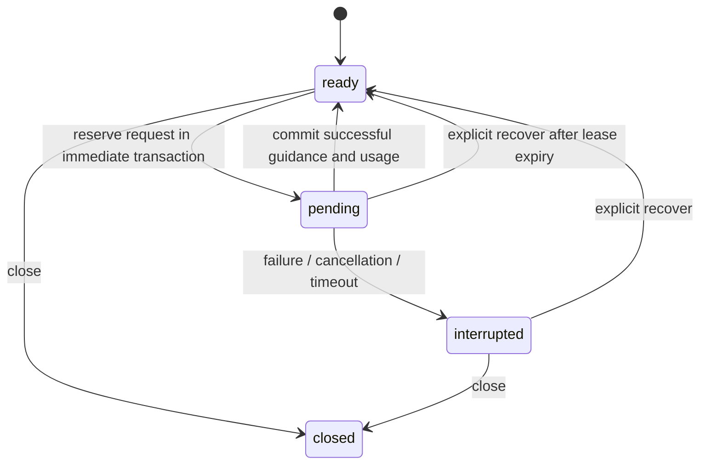

# Architecture and contracts

GC_Bridge is a channel, not a second coding harness. The host's active model is the executor. A separately configured director receives only explicit text and has no tools. The same `Bridge` service backs OMP extension, MCP and CLI.

| Module | Responsibility |
| --- | --- |
| `config.ts` | Strict local configuration validation; environment variable reference, protocol, model and limits |
| `protocol.ts` | Authoritative request validation and public tool description |
| `prompts.ts`, `handoff.ts` | Mode guidance and validation of the brief artifact |
| `provider.ts` | OMP model construction and inference; controlled fetch origin, no redirects/replays; safe errors |
| `store.ts` | SQLite WAL, durable session/request records, transactions |
| `bridge.ts` | Bounded consultation state machine and local session operations |
| `extension.ts`, `mcp.ts`, `cli.ts` | Thin adapters for native OMP, MCP stdio and terminal |

## Request

All entrances validate the same object:

- `operation`: `consult` (default), `get`, `list`, `export`, `close`, `recover`.
- `mode`: `explore`, `brief` (default), `review`, `discuss`.
- `prompt`: required for consultation; `context`: optional explicitly selected text.
- `sessionId`: optional for a new consultation, required for non-list local operations.
- `requestId`: optional UUID for durable idempotency. Provide one before sending if delivery is uncertain.
- `title`: optional new-session label.

Consultation returns `sessionId`, `requestId`, `mode`, `text`, `usage`, `totalTokens`, `truncated`, `estimatedCostUsd`, `advisory: true`; brief also returns `handoff: {valid,fields,artifact}`. Invalid structured output is preserved and reported, never silently retried or executed. `text` is always visible director output; private reasoning blocks and opaque provider response data are discarded.

The handoff artifact has `goal`, `concept`, `userJourney`, `constraints`, `implementationSteps[{title,description,acceptanceCriteria}]`, `risks`, `openQuestions`. Arrays for journey, steps and per-step acceptance criteria are nonempty. Validation checks shape, not truth or implementation feasibility. The host must inspect project code and user constraints.

## State and concurrency

SQLite stores sessions and idempotency records. Immediate transactions atomically check limits, reserve request IDs and claim a session. Cross-process global concurrency counts active leases. Same-session parallel consultation is rejected. The lease is provider timeout plus 30 seconds; recovery cannot reclaim a live lease. A pending request ID fences late results after explicit recovery. Successful retries of the exact request ID return the durable result; failed requests are retained as failed.

Configuration fingerprints prevent accidental model/protocol changes in existing sessions. Cache affinity uses the session ID through OMP. No request is retried or moved to another provider automatically. The fetch wrapper allows at most one network dispatch per consultation; OMP compatibility fallbacks that require replay are deliberately blocked. Configure compatible parameters explicitly instead.

UTF-8 byte length is used as a conservative request reservation for common byte-based tokenizers, plus output limit. This is not a provider tokenizer count or financial cap. Both configured context window and session token limits are checked before dispatch; provider-reported usage replaces estimates after success. Failed/incomplete upstream billing is unknown and cannot be safely deducted. Output limits include reasoning according to the provider. No price is assumed for custom aliases; missing pricing yields `null` cost estimates.

## Boundaries and limitations

- No automatic file/context collection, model tool execution, hidden chain-of-thought relay or autonomous coding agent spawning.
- Codex MCP is stdio only; the GUI and explicit headless background use separately authenticated loopback HTTP endpoints. Neither is remotely bound.
- The local database contains selected context and generated guidance in plaintext. Use private storage and filesystem permissions. Windows ACL policy is inherited from the user-selected location.
- Session `get` returns committed turns, not in-flight partial text. `export` returns Markdown; callers decide whether to save it.
- `recover` means acknowledging an unknown result; it does not recover provider responses or guarantee billing outcome.
- Versions are pinned because OMP extension and model contracts evolve. Upgrade SDKs with contract and transport tests.
- OMP interactive shutdown, native Windows execution and real providers beyond the tested route need acceptance on their target machines. CI defines Linux/Windows checks but a committed workflow is not evidence of completed CI runs.

## On-demand GUI and shared headless service (0.2)

Codex MCP is now a lightweight Manager adapter. Only explicit start spawns daemon.ts, which owns a real tool-free OMP Agent harness in headless.ts. It reuses OmpProvider for guarded inference, and Bridge/Store for durable history. Agent objects are bounded and discard local message arrays after each turn; SQLite owns conversation state. Ordinary consult while stopped returns BRIDGE_DISABLED. History operations remain local and available while stopped. A per-workspace selection is persisted; request selection is bound before consultation so retries remain idempotent even when the selected discussion changes.

The daemon and GUI have separate random loopback ports/tokens. The daemon token is stored only in a private state file and never returned to model tools. GUI configuration uses a distinct browser capability, safe readback and explicit save. Windows launchers use WSL path conversion; Windows Codex MCP uses wsl.exe with a pinned distribution while WSL Codex uses bash directly. Both target the same user config/storage. The shipped runtime is SDK-based headless OMP, not an interactive coding-agent CLI with ambient tools. Native /gc remains in OMP; Codex uses its documented Skill/MCP entrypoints.

## Discussion configuration and 1M default

`director.contextWindow` defaults to 1,000,000 tokens. `limits.maxInputChars` defaults to 1,000,000 characters, while cumulative `maxSessionTokens` stays 100,000 to keep spending control independent. Actual acceptance uses a conservative UTF-8-byte reservation, not a calibrated tokenizer; configuring 1M does not assert provider support. The user can adjust the independent limits in the GUI.

`discussion.role` defaults to discussion partner, and `discussion.taskInstructions` defaults to empty/free discussion. Both are editable in the GUI, persisted in private config, included in effective system instructions and input-size estimates, and fingerprinted with model settings. A changed role/task requires a new conversation; read/export of old history remains available. The default request mode is discuss; project inspection, analysis, briefs and review are optional tasks, not startup side effects.

## Workspace state, previews and independent opinions (0.3)

Schema v3 adds private preview state; session JSON gains workspaceData for branch provenance, profile ID, inherited usage, opinions, explicit context materials and immutable stage snapshots. Workspace mutations run in immediate transactions and reject pending sessions to avoid losing annotations during a turn commit. Snapshots serialize visible transcript and current opinion state; side-by-side comparison is local. Branches copy an exact prefix of message pairs and turn records without altering the original.

Context selection filters only provider-bound message history. Bridge appends the new message pair to the complete archive, so deselection never deletes old messages. Effective input limits and existing budget reservations still apply. Preview records bind selected input to config fingerprint and source revision, expire before first send, and use a per-preview lease plus stable request IDs to prevent concurrent replay. Multi-model targets use fresh profile-specific sessions seeded with the same selected prior history. They execute sequentially under the existing concurrency limits and store each success/failure independently; unknown results are not silently retried or synthesized. One explicit comparison may consume up to four separately billed requests.

Model profiles and presets share the existing strict config validator. Profile IDs and credential-variable names must be unique. Credentials migrate from the legacy directorApiKey field into a private keys map; keys are never returned by the GUI, and saved keys cannot silently move to another endpoint. Existing user config without profiles/presets loads empty arrays. The app remains opt-in and has no background debate loop.

## Standalone platform layer

entry.ts sets the per-OS private native cache before dynamically importing the application. Build plugins embed GUI/skill/default config and native zstd frames; OMP's own versioned/hash extraction loader is reused. paths.ts distinguishes packaged self-spawn from source execution. Windows/macOS/Linux user paths and browser commands are selected natively. The app is a local browser GUI, not a second coding harness.

Detection is read-only and separate from injection. CLI/Desktop/WSL targets have individual editable config roots and explicit injection controls. Native writes lock, validate TOML, check content fingerprints and rename; WSL writes lock/check in the target distro. Shared configuration is a user-visible constraint, not an independent per-client switch.
